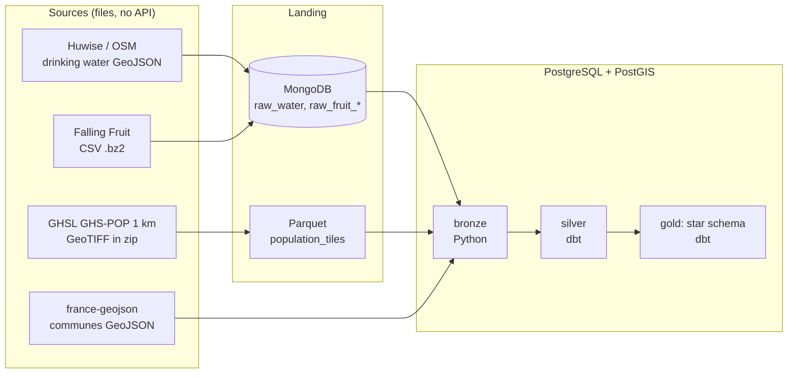
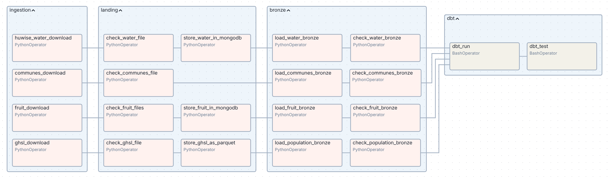
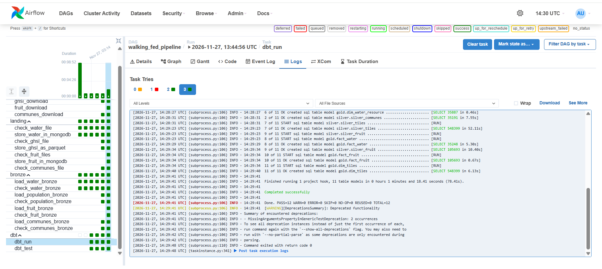
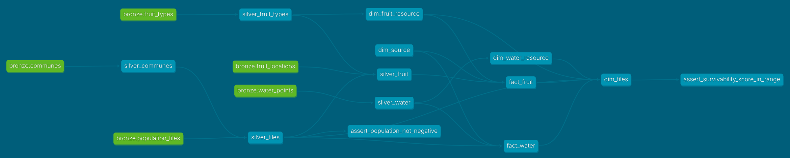
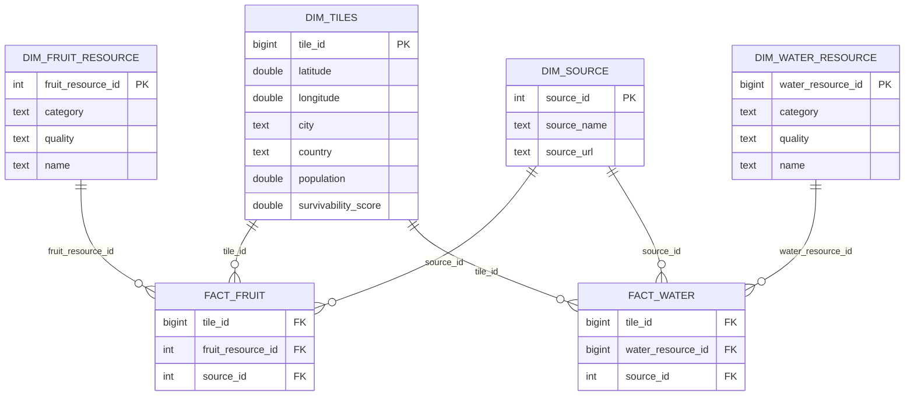

# SMART PLD Template Repository


Template by [Riccardo Tommasini](riccardotommasini.com/) from [INSA Lyon](https://www.insa-lyon.fr/).

Students: Simon Weber, Victor Kindberg , Younes El Majdoubi El Idrissi

### Abstract
In the case of a zombie apocalypse, where in the world would you be most likely to survive on forageable food, drinking water and shelter alone?
## Description 
The Walking Fed is an interactive map that shows you how likely you would be to survive a zombie apocalypse in any given location and whether it would make sense to move to a different close-by location. It combines data about publicly available sources for food and potable water, shelter locations and population density, the later serving as a proxy for the amount of zombies in a given area. 

## Project Objectives

Answer the business questions of Project 1 for metropolitan France, on a grid of 1 km tiles:

1. Are highly populated areas safer than rural areas?
2. What is the most prevalent food type in France?
3. In the case of a zombie apocalypse, should I flee my current location or stay?
4. Which city is the safest in France?
5. How many of the water sources are of good quality?

Key metrics: **Data Ingestion Rate** and **Usable Data Percentage**.

### Architecture



Everything is orchestrated by one Airflow DAG, `walking_fed_pipeline`, and runs in Docker Compose.

| Lifecycle stage | Tool | Role |
|---|---|---|
| Orchestration | Airflow 2.10.5 (LocalExecutor) | Downloads, loads, checks, then runs dbt |
| Environment | Docker Compose | Same services on every machine |
| Landing zone | MongoDB 8.0, Parquet | Raw Falling Fruit and OSM documents; GHSL cells of the study area |
| Bronze | PostgreSQL 16 + PostGIS 3.4, Python | Raw tables, one version per source file |
| Silver, gold | dbt 1.12 (dbt-postgres 1.9) | Cleaning, spatial integration, star schema, tests |

Changes from Project 1: the production zone is PostgreSQL instead of DuckDB (the course requires Postgres and dbt), Redis and Neo4j are not used, GHSL is used at 1 km instead of 100 m (all of France at 100 m is about 55 million cells), and the french-geojson commune boundaries were added to give each tile its city.

## Requirements

- **Docker Desktop** (or Docker Engine with Compose v2), with at least **4 GB of memory** for Docker.
- About **3 GB of free disk** (images, source files and database volumes).
- An internet connection for the first run: the DAG downloads the source files itself (about 360 MB, mostly GHSL).

Everything else is installed in the containers, with pinned versions:

| Component | Version |
|---|---|
| `postgis/postgis` | 16-3.4 |
| `mongo` | 8.0 |
| `postgres` (Airflow metadata) | 16 |
| `apache/airflow` | 2.10.5-python3.11, with the official constraints file |
| Python packages (Airflow image) | `pymongo`, `pyarrow`, `rasterio==1.4.3` (`docker/airflow/requirements.txt`) |
| dbt (separate virtual environment in the Airflow image) | `dbt-core==1.12.7`, `dbt-postgres==1.9.0` |

## How to Run the Project

1. Clone the repository and switch to this branch:
   ```
   git clone https://github.com/simonwbr/The-Walking-Fed.git
   cd The-Walking-Fed
   git checkout assignment-2-younes
   ```
2. Create the environment file from the template (change the passwords if you like):
   ```
   cp .env.example .env
   ```
3. Build the Airflow image and start all services:
   ```
   docker compose up -d --build
   ```
4. Open Airflow at http://localhost:8080 and log in with `AIRFLOW_ADMIN_USER` / `AIRFLOW_ADMIN_PASSWORD` from `.env`.
5. Unpause `walking_fed_pipeline` and trigger it (▶ → *Trigger DAG*). The default parameters work as they are. The first run takes 10 to 20 minutes, mostly to download GHSL.
6. When every task is green, run the analytical queries:
   ```
   # Linux / macOS
   docker compose exec -T postgres psql -U walkingfed -d walking_fed < sql/business_questions.sql
   # Windows PowerShell
   Get-Content sql/business_questions.sql | docker compose exec -T postgres psql -U walkingfed -d walking_fed
   ```

The pipeline can be triggered again at any time: files already downloaded or loaded are skipped (SHA-256 of each file), and no duplicate is created.

On Linux, if Airflow cannot write to `data/` or `logs/`, add `AIRFLOW_UID=<output of id -u>` to `.env`.

### Environment variables

Set in `.env` (template: `.env.example`, never commit `.env`):

| Variable | Used by | Meaning |
|---|---|---|
| `POSTGRES_USER`, `POSTGRES_PASSWORD` | PostgreSQL, Airflow, dbt | Warehouse credentials (database `walking_fed`) |
| `MONGO_USER`, `MONGO_PASSWORD` | MongoDB, Airflow | Landing zone credentials |
| `AIRFLOW_DB_PASSWORD` | Airflow metadata database | |
| `AIRFLOW_SECRET_KEY` | Airflow webserver | Any long random string |
| `AIRFLOW_ADMIN_USER`, `AIRFLOW_ADMIN_PASSWORD` | Airflow | Web UI login created at start-up |

Set in `docker-compose.yml` for the Airflow containers:

| Variable | Value | Meaning |
|---|---|---|
| `DATA_DIR` | `/opt/airflow/data` | Root of the raw and landing files |
| `MONGO_URI` | built from the Mongo credentials | Landing zone connection |
| `POSTGRES_HOST`, `POSTGRES_PORT`, `POSTGRES_DB` | `postgres`, `5432`, `walking_fed` | Warehouse connection (Python loaders and dbt `profiles.yml`) |
| `DBT_BIN`, `DBT_PROJECT_DIR` | `/opt/airflow/dbt_venv/bin/dbt`, `/opt/airflow/dbt` | dbt executable and project |
| `STUDY_AREA_BBOX` (optional) | metropolitan France | JSON bounding box of the study area |

### DAG parameters

Each source file is stored under `data/raw/<source>/<file date>/`, so a run is parameterised by the version of each file:

| Parameter | Default | Meaning |
|---|---|---|
| `water_file_date` | `2026-11-24` | Version of the drinking water export |
| `population_file_date` | `2026-11-27` | Version of the GHSL file |
| `ghsl_epoch` | `2025` | GHSL population year (1975 to 2030, every 5 years) |
| `fruit_file_date` | `2026-11-27` | Version of the Falling Fruit export |
| `communes_file_date` | `2026-11-27` | Version of the commune boundaries |

## Airflow DAG

One DAG, four task groups, 21 tasks. Each source has its own branch (download → file check → landing → bronze → data quality check); dbt starts only when the four bronze checks have passed.



A complete run, with every task green, and the `dbt_run` log:



Data quality checks (a failed check fails the task and stops the pipeline before dbt):

| Task | Checks |
|---|---|
| `check_*_file` | file is a valid GeoJSON / zip / bz2 CSV, with the expected content and columns |
| `check_water_bronze` | row count = MongoDB, no duplicate OSM id, no missing coordinates, coordinates in range |
| `check_population_bronze` | row count = Parquet, unique `tile_id`, no null or negative population, total > 0 |
| `check_fruit_bronze` | row counts = MongoDB, unique ids, every location has a type, coordinates in the study area, at most 1% of links to an unknown type |
| `check_communes_bronze` | row count = file, unique commune code, no missing code or name, at most 1% without geometry |

## dbt DAG



- **Silver** (`silver` schema): `silver_water`, `silver_tiles`, `silver_communes`, `silver_fruit`, `silver_fruit_types`. Latest file only, deduplicated, typed, with PostGIS geometries (GIST indexes). Each tile gets its commune by a point-in-polygon join; each fruit and water point gets its `tile_id` with the same grid formula as the population (macro `tile_id`).
- **Gold** (`gold` schema): the star schema of Project 1, unchanged. `fact_fruit`, `fact_water` and `dim_water_resource` are **incremental** (only new or changed rows are written; rows that disappeared from the latest file are removed), `dim_tiles` is rebuilt because its score depends on all resources.
- **Tests**: about 50 tests (unique, not null, accepted values, relationships between facts and dimensions, survivability score between 0 and 100). Documentation in `dbt/models/silver/schema.yml` and `dbt/models/gold/schema.yml`.

### Data model (gold)



- `tile_id` = `grid_row * 1,000,000 + grid_col` of the GHSL world grid, so the neighbours of a tile are `tile_id ± 1` (west, east) and `tile_id ± 1,000,000` (north, south).
- Fruit `category` and `quality` come from the genus: good = fruits, berries and real nuts (walnut, hazel, chestnut); medium = acorns, beech nuts, linden leaves and flowers; bad = little food value (ash seeds, maple sap...).
- Water `quality` counts three criteria: free, outdoors, updated on OpenStreetMap in the last 5 years (3 = good, 2 = medium, 0-1 = bad).
- `survivability_score` (0 to 100) = `100 × √(food score × water score) × (1 − zombie threat)`, where each score is `x / (x + half)`: food and water are both needed, and more inhabitants means more zombies. The weights and half-saturation constants are dbt variables in `dbt_project.yml`.

## Results

Queries: [`sql/business_questions.sql`](sql/business_questions.sql). Results of the run of 27 November 2026 (548,399 tiles, 105,693 fruit resources, 35,248 water points).

**Q1. Are highly populated areas safer than rural areas?** (threshold: 1,500 inhabitants per km²)

| population_group | tiles | avg_survivability_score | % tiles with food and water |
|---|---:|---:|---:|
| highly_populated | 7,954 | 0.69 | 10.0 |
| low_population | 540,445 | 0.01 | 0.1 |

Dense areas score higher, but mainly because Falling Fruit is made of city tree inventories: only 0.1% of rural tiles have recorded food and water at all.

**Q2. What is the most prevalent food type in France?**

| name | category | quality | occurrences |
|---|---|---|---:|
| English Oak | nut | medium | 11,906 |
| European Ash | other | bad | 5,502 |
| Pin Oak | nut | medium | 3,848 |
| Silver Linden | leaves and flowers | medium | 3,445 |
| Black Locust | leaves and flowers | medium | 3,065 |

By category: nut 38,455; other 23,959; leaves and flowers 17,905; tree fruit 15,503; berry 9,871.

**Q3. Should I flee my current location or stay?** (example: Lyon, place Bellecour)

| tile_id | city | latitude | longitude | population | survivability_score | advice |
|---|---|---:|---:|---:|---:|---|
| 3576018427 | Lyon | 45.7694 | 4.8263 | 17,246 | 3.30 | FLEE HERE |
| 3577018427 | Lyon | 45.7601 | 4.8258 | 8,310 | 3.17 | |
| 3578018429 | Lyon | 45.7508 | 4.8502 | 18,429 | 1.56 | |
| 3576018428 | Lyon | 45.7694 | 4.8388 | 19,636 | 1.42 | |
| 3577018429 | Lyon | 45.7601 | 4.8507 | 22,681 | 1.23 | |
| 3577018428 | Lyon | 45.7601 | 4.8383 | 15,161 | 0.00 | you are here |

Flee: the tile to the north-west has a higher score.

**Q4. Which city is the safest in France?** (cities with at least 5 tiles)

| city | tiles | population | avg_survivability |
|---|---:|---:|---:|
| Billère | 5 | 12,523 | 13.73 |
| Vezin-le-Coquet | 8 | 4,593 | 13.50 |
| Lormont | 9 | 19,878 | 10.55 |
| Bègles | 10 | 25,231 | 10.33 |
| Grenoble | 17 | 141,758 | 9.92 |
| Bordeaux | 48 | 249,133 | 9.69 |
| Rennes | 52 | 216,577 | 8.55 |

**Q5. How many of the water sources are of good quality?**

| quality | water sources |
|---|---:|
| good | 24,796 (70.3%) |
| medium | 10,304 |
| bad | 148 |
| **total** | **35,248** |

**KPI 1. Data Ingestion Rate** (rows ingested into bronze, last load)

| source | rows ingested |
|---|---:|
| GHSL population cells | 949,288 |
| Falling Fruit locations (metropolitan France) | 259,764 |
| OSM drinking water | 36,279 |
| Communes | 35,228 |
| Falling Fruit types | 4,938 |

**KPI 2. Usable Data Percentage** (share of bronze records that reach the gold layer)

| source | bronze records | gold records | usable |
|---|---:|---:|---:|
| OSM drinking water | 36,279 | 35,248 | 97.2% |
| GHSL population cells | 949,288 | 548,399 | 57.8% (sea and neighbouring countries removed) |
| Falling Fruit (location × type) | 261,122 | 105,693 | 40.5% (non-forageable, hidden, pending types and points outside France removed) |

## Project layout

```
dags/walking_fed_pipeline.py   the Airflow DAG
src/ingestion/                 landing loaders (MongoDB, Parquet)
src/bronze/                    bronze loaders (PostgreSQL)
src/quality/                   bronze data quality checks
dbt/                           dbt project: silver and gold models, macros, tests, YAML docs
sql/business_questions.sql     analytical queries (Q1-Q5, KPIs)
docker/airflow/                Airflow image (Dockerfile, requirements)
docker-compose.yml             services
.env.example                   environment template
```

## Data sources and licences

- Falling Fruit, https://fallingfruit.org/about/data (mostly CC BY-NC-SA)
- Huwise / OpenStreetMap, France drinking water, https://hub.huwise.com/explore/assets/osm-france-drinking-water/ (ODbL)
- GHSL GHS-POP R2023A, European Commission JRC, https://human-settlement.emergency.copernicus.eu/download.php?ds=pop (CC BY 4.0)
- france-geojson communes, https://github.com/gregoiredavid/france-geojson

## Checklist

- [ ] Clone the created repository offline;
- [ ]  Add your name and surname to the Readme file and your teammates as collaborators
- [ ] Complete the field above after the project is approved
- [ ]  Make any changes to your repository according to the specific assignment;
- [ ]  Ensure code reproducibility and instructions on how to replicate the results;
- [ ]  Add an open-source license, e.g., Apache 2.0;
